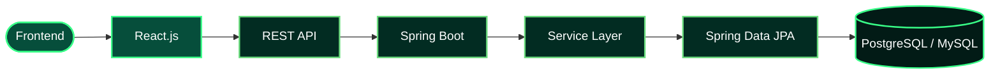

<div align="center">


<br/>


<br/><br/>

<a href="https://www.linkedin.com/in/pranjali-hule-a10660248/">

</a>

<a href="https://github.com/pranju1711">

</a>


</div>


<div align="center">


</div>

<table>
<tr>
<td width="58%" valign="top">

### Hello, I'm Pranjali Hule 👋

I'm a Computer Science and Engineering graduate passionate about **Java Full Stack Development and Software Engineering**.

I enjoy building practical applications, developing REST APIs, working with databases, and solving real-world problems through technology.

- ☕ Strong interest in Java and OOP.
- 🚀 Developing backend applications using Spring Boot.
- 🎨 Building responsive interfaces using React.js.
- 🗄️ Working with MySQL, PostgreSQL, and MongoDB.
- 🔗 Developing and testing REST APIs using Postman.
- 📚 Currently undergoing Java Full Stack training at QSpiders.

</td>
<td width="42%" valign="top">

```yaml
name: Pranjali Hule
role: Java Full Stack Developer
education: B.Tech Computer Science
training: QSpiders
location: India

languages:
  - Java
  - JavaScript
  - SQL
  - Python

backend:
  - Spring Boot
  - Hibernate
  - REST APIs

frontend:
  - React.js
  - HTML
  - CSS

database:
  - MySQL
  - PostgreSQL
  - MongoDB

status: Open to opportunities
```

</td>
</tr>
</table>

> [!TIP]
> **Career Goal:** To start my career as a Software Developer, contribute to real-world projects, and continuously improve my technical skills.


<div align="center">


<br/><br/>


</div>

| Domain | Technologies |
|:---|:---|
| Programming Languages | Java, JavaScript, Python, C, C++, SQL |
| Backend Development | Core Java, Advanced Java, Spring Boot, Spring MVC, Hibernate, JPA |
| Frontend Development | HTML5, CSS3, JavaScript, React.js |
| Databases | MySQL, PostgreSQL, MongoDB |
| API Development | REST APIs, CRUD Operations, Postman |
| Computer Science | OOP, Collections, Exception Handling, DSA, DBMS |
| Tools | Git, GitHub, VS Code, IntelliJ IDEA, Eclipse |


<div align="center">


</div>




<div align="center">


</div>

<table>
<tr>
<td width="50%" valign="top">

### 🤖 AI Interviewer

**MERN Stack Project**

An AI-powered interview practice application designed to help candidates prepare for technical interviews.

**Key Features**
- Interactive interview interface.
- REST API development.
- AI-based interview evaluation and feedback.
- MongoDB session and response storage.
- Interview feedback history.

**Tech Stack**


</td>
<td width="50%" valign="top">

### 🏭 Industrial Machine Maintenance Management System

**Java Spring Boot Project**

An application designed to manage industrial machines and maintenance activities.

**Key Features**
- Machine and category management.
- Technician management.
- Fault logging.
- Maintenance history.
- Maintenance cost and downtime tracking.
- REST API and CRUD operations.

**Tech Stack**


</td>
</tr>
<tr>
<td width="50%" valign="top">

### 🧠 AI-Powered SQL Bug Analyzer

**Full Stack MERN Project**

An application designed to analyze SQL queries and assist with identifying and fixing SQL errors.

**Key Features**
- SQL query analysis.
- Error identification.
- AI-assisted query correction.
- REST API integration.
- Full-stack application development.

**Tech Stack**


</td>
<td width="50%" valign="top">

### 📊 Olympic Data Analysis

**Power BI Project**

A data analysis project exploring Olympic historical data and athlete performance.

**Key Features**
- Data cleaning and transformation.
- Power Query.
- DAX measures.
- Interactive Power BI dashboards.
- Athlete and country-level analysis.

**Tech Stack**


</td>
</tr>
</table>

<div align="center">

<a href="https://github.com/pranju1711?tab=repositories">

</a>

</div>


<div align="center">


</div>

### 🎓 Bachelor of Technology – Computer Science and Engineering

**Shri Tuljabhavani College of Engineering, Tuljapur**

2022 – 2026 | CGPA: 9.00

### 📚 Java Full Stack Developer Training

**QSpiders, Pune | 2026 – Present**

- Core Java
- Advanced Java
- Data Structures and Algorithms
- Java Full Stack Development


<div align="center">


<a href="https://github.com/ryo-ma/github-profile-trophy">

</a>

</div>


<div align="center">


<br/><br/>

<a href="https://github.com/pranju1711">

</a>

<a href="https://github.com/pranju1711">

</a>

<br/><br/>


</div>


<div align="center">


</div>


<div align="center">


<picture>
  <source media="(prefers-color-scheme: dark)" srcset="https://raw.githubusercontent.com/pranju1711/pranju1711/output/github-contribution-grid-snake-dark.svg"/>
  <source media="(prefers-color-scheme: light)" srcset="https://raw.githubusercontent.com/pranju1711/pranju1711/output/github-contribution-grid-snake.svg"/>
  
</picture>

</div>


<div align="center">


<br/><br/>


</div>


<div align="center">


<br/>

**Interested in Java Development, Full Stack Development, and Software Engineering? Let's connect!**

<br/>

<a href="https://www.linkedin.com/in/pranjali-hule-a10660248/">

</a>

<a href="https://github.com/pranju1711">

</a>

<br/><br/>


</div>
